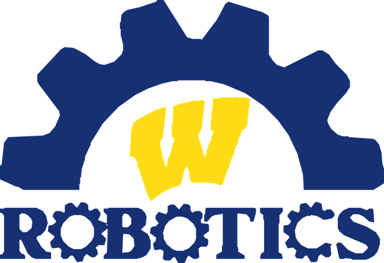
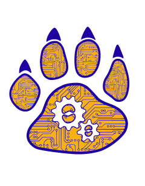

  <picture>
    <source media="(prefers-color-scheme: dark)" srcset="assets/wyandotte-robotics-bright.png">
    
  </picture>

  <b>Home of the BearBots.</b> Students in grades 6–12 in Wyandotte, Michigan, designing, building and programming competition robots since 2017.

  <a href="https://wyandotterobotics.com">Website</a> ·
  <a href="https://wyandotterobotics.com/calendar">Calendar</a> ·
  <a href="https://wyandotterobotics.com/join">Join the team</a> ·
  <a href="https://wyandotterobotics.com/sponsorship">Become a sponsor</a> ·
  <a href="https://wyandotterobotics.com/give">Support the team</a>

## Our teams

<table>
  <tr>
    <td width="50%" valign="top">
      <h3>FRC Team 8124 · RHS BearBots</h3>
      
<i>FIRST</i> Robotics Competition at Roosevelt High School. Full-size robots, designed and built after the game is revealed at kickoff in January.

      

        <a href="https://www.thebluealliance.com/team/8124">The Blue Alliance</a> ·
        <a href="https://frc-events.firstinspires.org/team/8124">FRC Events</a>
      

    </td>
    <td width="50%" valign="top">
      <h3>FTC Team 14158 · WMS BearBots</h3>
      
<i>FIRST</i> Tech Challenge at Wilson Middle School. Smaller robots, a season that runs from September through spring.

      

        <a href="https://ftcscout.org/teams/14158">FTCScout</a>
      

    </td>
  </tr>
</table>

## What's here

| Repository | What it is |
| --- | --- |
| [ftc-14158-2026-27](https://github.com/Wyandotte-Robotics/ftc-14158-2026-27) | FTC 14158 robot code for the 2026–27 season, built on the official FTC SDK |
| [frc-8124-2027](https://github.com/Wyandotte-Robotics/frc-8124-2027) | FRC 8124 robot code for the 2027 season (starts at kickoff in January) |
| [.github](https://github.com/Wyandotte-Robotics/.github) | This page, plus the contributing guide and templates every repo shares |

## Get involved

- **Students and families:** sign up at [wyandotterobotics.com/join](https://wyandotterobotics.com/join).
- **Businesses and sponsors:** see [what sponsorship supports](https://wyandotterobotics.com/sponsorship), or [meet our sponsors](https://wyandotterobotics.com/sponsors).
- **Mentors:** engineers, programmers and makers are always welcome. [Get in touch](https://wyandotterobotics.com/contact).

   
  A program of Wyandotte Public Schools, supported by the Wyandotte Robotics Boosters. 
  We compete with <a href="https://www.firstinspires.org/">FIRST</a> and follow its Core Values and Gracious Professionalism®.

